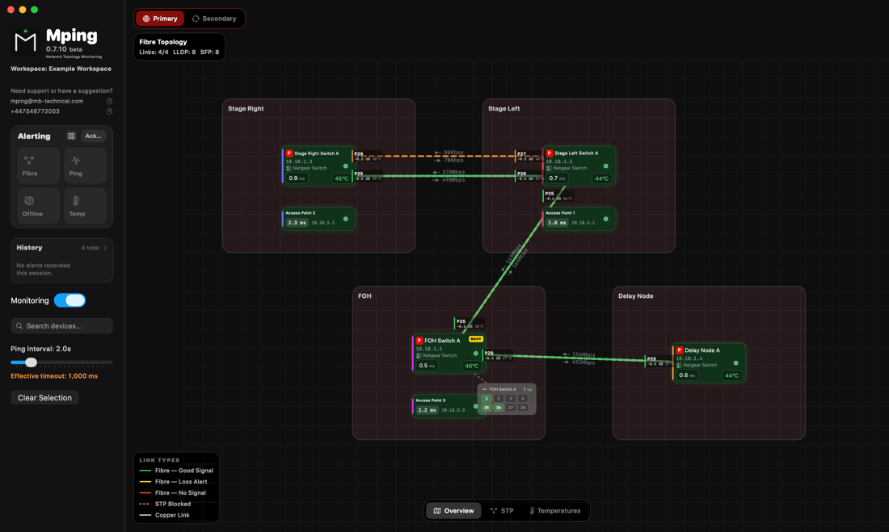
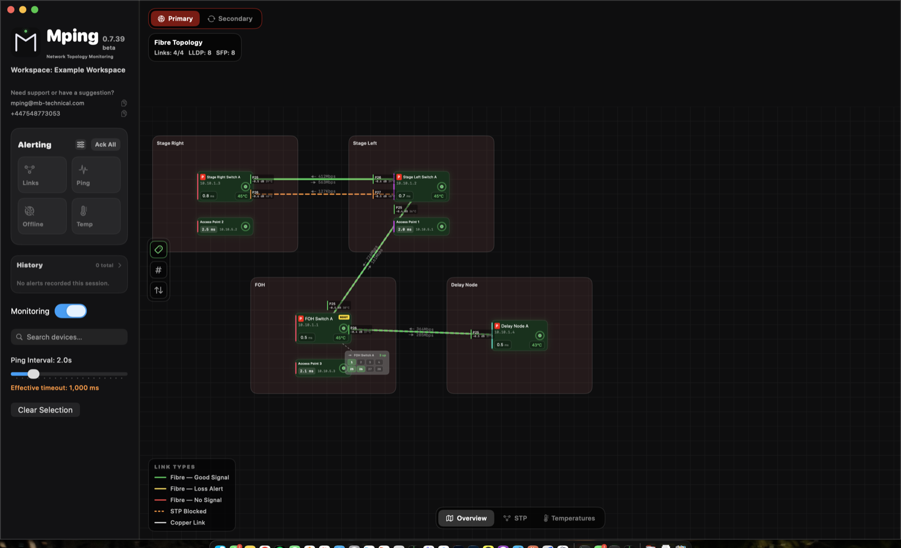
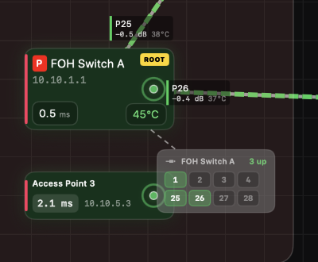
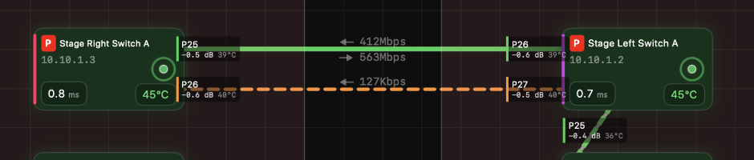
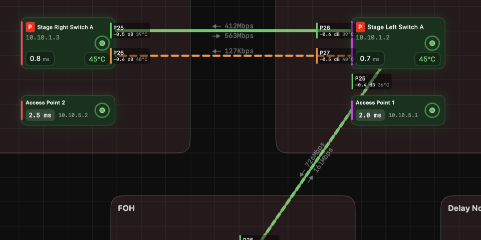
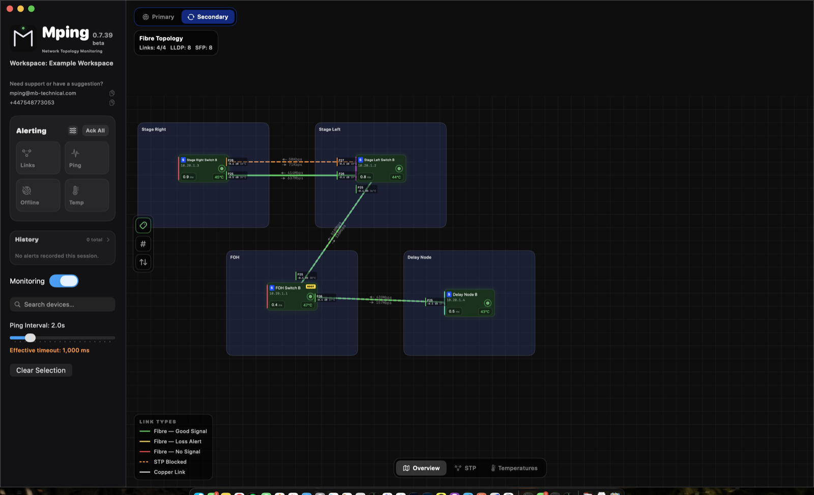
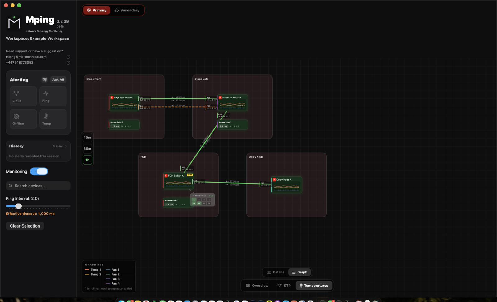
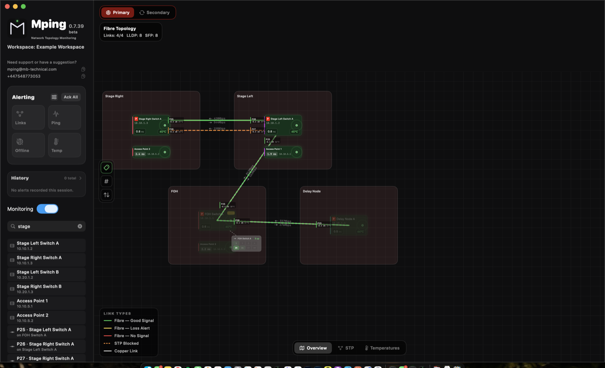
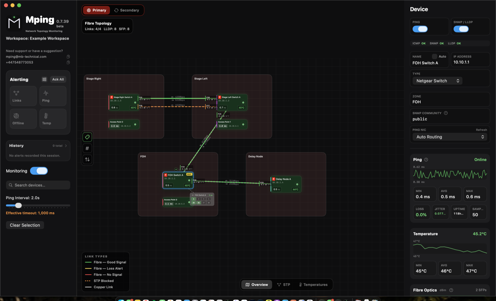
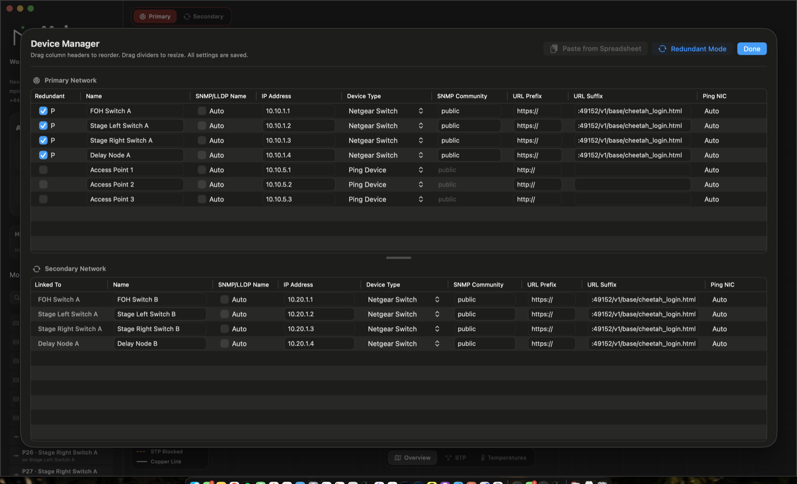

  

<h1 align="center">Mping</h1>

  <strong>Professional network monitoring for live event production.</strong> 
  Built for touring, festival, fixed installation, and live broadcast engineers.

  
  
  
  

---

## What is Mping?

Network monitoring built for show engineers, not IT departments. Everything on one canvas, readable at a glance from the FOH position.

- Know the instant a device drops — with **no false alerts**
- Your whole network as an interactive topology map
- The numbers that matter: RTT, jitter, packet loss, fibre loss, SFP temperature and signal
- Built around **Netgear AV**, **AVB/Milan**, **L-Acoustics** and fibre rigs

## Features

*Every screenshot below is Mping's built-in example workspace — a redundant four-switch fibre rig with access points — exactly as the app draws it.*

### The whole rig on one canvas

Every switch, amplifier and access point is a live tile — round-trip time, temperature and status readable from across the room. Fibre links are discovered automatically over LLDP and drawn with **per-end optical loss in dB** and **live per-port bandwidth**. Traffic direction animates toward the root bridge, and a blocked redundant path is drawn as exactly that — an orange dashed line, not a healthy link. Zone boxes group the rig the way it is racked, tiles drag freely, and a venue plan can sit behind everything (PNG, JPEG or PDF, with smart invert so black-on-white drawings read correctly on the dark canvas).

<table>
<tr>
<td width="55%" valign="top">

### Ping you can trust

A device is **never marked offline until a verification burst confirms it** — one lost packet on a busy network does not page you. Round-trip times are stamped by the kernel at packet arrival, so the numbers match `ping` in a terminal instead of inheriting the app's scheduling noise. Loss %, jitter and uptime are tracked per device, and jitter alerts only fire on a breach sustained across consecutive real cycles.

</td>
<td width="45%" valign="top">

</td>
</tr>
<tr>
<td width="55%" valign="top">

### Fibre and SFP optics, per module

Optical TX/RX power, temperature, voltage and laser bias for every SFP, read over DDM. Link labels carry the measured **loss of each direction** of every span, with alerts on your dB threshold — and a link whose light disappears goes red immediately. Copper SFPs are told apart from optical automatically, so the map never claims fibre where there is none.

</td>
<td width="45%" valign="top">

</td>
</tr>
<tr>
<td width="55%" valign="top">

### Spanning tree, drawn honestly

STP state lives right on the map: the root bridge wears a gold badge, blocked redundant paths draw as dashed amber, and traffic-flow arrows animate toward the root — computed from the switches' own designated-bridge votes. If the data cannot prove a direction, Mping draws **no arrow rather than a guessed one**.

</td>
<td width="45%" valign="top">

</td>
</tr>
<tr>
<td width="55%" valign="top">

### Redundant networks are first-class

Primary and secondary planes as two tabs of one workspace. Devices pair with their redundant twins, share canvas position and port-box layout, and wear P/S badges. Each plane keeps its own topology, its own link map and its own alert focus — clicking a secondary alert takes you to the secondary plane.

</td>
<td width="45%" valign="top">

</td>
</tr>
<tr>
<td width="55%" valign="top">

### Heat, before it becomes a problem

Both temperature sensors and all four fans of every switch, polled continuously with configurable alert thresholds. The Temperatures plane turns every tile into a **rolling one-hour graph** of sensors and fans, with hover readouts — a quiet rack at load-in and a hot one at showtime are one glance apart.

</td>
<td width="45%" valign="top">

</td>
</tr>
<tr>
<td width="55%" valign="top">

### Search that knows your patch

Search matches devices — and **switch ports**, by LLDP neighbour name or by the endpoint IP resolved from the switch's own learned-MAC and ARP tables. Type an device's IP and Mping finds the port it is plugged into, opens that switch's port box, and flashes the exact cell.

</td>
<td width="45%" valign="top">

</td>
</tr>
<tr>
<td width="55%" valign="top">

### One click, whole story

The inspector shows a device's live RTT sparkline, loss, jitter and uptime, temperature history, and a card per SFP — TX/RX, temperature, voltage, bias, vendor and serial. Per-device toggles for ping and SNMP monitoring, and a protocols strip showing per-transport health at a glance.

</td>
<td width="45%" valign="top">

</td>
</tr>
<tr>
<td width="55%" valign="top">

### Set up a rig in minutes

Add a show's worth of devices in one action, then **paste names and IPs straight from a spreadsheet** — the table fills live as you paste. Bulk-edit zone, type, community and monitoring state across a selection. In redundant mode the manager pairs both networks side by side.

</td>
<td width="45%" valign="top">

</td>
</tr>
</table>

### And for the engineer who reads spec sheets

- **Port status boxes** — a draggable companion per switch that replicates the physical racks with your kit in: per-column heights, drag-in placement, cells labelled with LLDP name, endpoint IP or drop counters, red-until-verified on reopen
- **Alerts that latch** — offline, RTT, jitter, fibre loss and temperature alerts stand until acknowledged, with full history; recovered-but-unacknowledged shows amber, and macOS notifications reach you when Mping is in the background
- **Hold ⌥ Option** to flip every tile's IP to its MAC address, learned live from the network
- **Honest by design** — topology memory is session-only: every launch draws only what the switches prove now, never yesterday's assumptions
- **One portable file** — a workspace is a single `.mpw` including the venue plan; open it on another Mac and the whole rig comes with it
- **Multi-NIC aware** — ping and SNMP bind to the interface you choose per device, built for FOH Macs riding two networks at once
- **Show-safe footprint** — engineered for low CPU and few wake-ups so the Monitoring Mac stays cool and silent; read-only throughout: Mping never writes a single setting to any device

---

## Install

1. Download **`Mping-x.y.z.dmg`** from the [**latest release**](https://github.com/therealjackiewelles/Mping/releases/latest)
2. Open it and drag **Mping** into Applications
3. **First launch: right-click Mping → Open**, then click Open again

> **Step 3 is not optional.** Mping is not yet notarised by Apple, so double-clicking it the first time shows a warning and refuses to launch. Right-click → Open is the way past it, and macOS only asks once. If macOS says the app is *"damaged"*, that is the same thing — the file is fine.

Workspaces are stored in `~/Documents/Mping`, never inside the app, so updates never touch your data.

**Updates:** Mping checks GitHub on launch and once a day. Feature releases offer to download and install themselves; patch releases are quiet — check any time via **Mping → Check for Updates…**. It is one anonymous request to GitHub. No account, no tracking.

---

## Setting up Netgear AV switches

Mping reads switch telemetry over SNMP — port status, temperatures, SFP levels, LLDP neighbours and STP state. The switch needs a read-only community string before any of that appears.

### 1. Create an SNMP community on the switch

In the switch's **main web UI** (not the AV UI), find the SNMP section — on M4250/M4300 it is under **System → SNMP → Community Configuration**.

- **Community string** — a name of your choosing, e.g. `mping`. This is effectively a password, so avoid `public` on a show network
- **Access mode** — **read-only**. Mping never writes to a switch, and read-write access is not needed
- **Client address** — restrict it to the Mac running Mping if your switch supports it, or leave open on a closed show network
- Make sure the community is **enabled**, and that SNMP itself is enabled on the switch

### 2. Add the switch in Mping

Right-click the canvas → **Add Device**, then in the inspector set:

- **IP address** of the switch
- **Type** → *Netgear Switch*
- **SNMP community** → the string you just created
- **Ping NIC** → the interface that reaches this switch

Telemetry appears on the next poll. If nothing arrives, open **Debugging → Console Output** and filter by subsystem to see exactly which OIDs were asked for and what came back.

### 3. What Mping does and does not do

Mping is **read-only by design**. It issues SNMP GET and WALK requests only, and never SET. It cannot change a switch's configuration, and the L-Acoustics HTTP integration is likewise GET-only.

---

## Redundant networks and dual NICs

A redundant rig usually means two physically separate networks — primary and secondary — often using **the same subnet on both**. That is where macOS gets in the way.

### The problem

With two NICs on overlapping subnets, macOS decides which interface to use from its routing table, not from which cable you meant. Replies arriving on the "wrong" interface are dropped by reverse-path filtering, so devices appear offline even though they are reachable.

### The fix — static host routes

Mping generates the routes for you. In **Preferences → Dual-NIC Static Routes**:

1. Set a specific **Ping NIC** on each device in the inspector — not *Auto Routing*. Only devices with an explicit NIC can be routed
2. Open the Dual-NIC Static Routes panel and press **Apply**
3. The commands are copied to your clipboard and Terminal opens — press **⌘V** then **Return**, and enter your admin password

This tells macOS exactly which interface to use for each device, so replies are accepted on the right one.

> **Remove the routes before you disconnect a NIC.** A static route pointing at an interface that is no longer there will black-hole all traffic to those devices until it is removed. The same panel has a **Remove** button.

### Primary and secondary

Once devices are paired, the **Primary / Secondary** tabs at the top of the canvas switch the whole view between the two networks. A secondary device sits in the same position as its primary, so the layout stays identical as you flip between them.

---

## Requirements

- macOS 13 Ventura or later
- Netgear AV switches for SNMP telemetry (any pingable device works for basic monitoring)
- A network route to the devices you want to monitor

---

## Ideas, questions and problems

- **Ideas & feature requests:** [Discussions](https://github.com/therealjackiewelles/Mping/discussions) — tell me what Mping should do. What you would use it for on a rig matters more than how it should work
- **Questions:** [Q&A](https://github.com/therealjackiewelles/Mping/discussions/categories/q-a)
- **Bugs:** [Issues](https://github.com/therealjackiewelles/Mping/issues)
- **Email:** mping@mb-technical.com · **Phone:** +44 7548 773053

[**How it works →**](ARCHITECTURE.md) — the system board: what runs when, and why.

---

## Trademarks & affiliation

Mping is an independent product. It is not affiliated with, endorsed by, or supported by NETGEAR or L-Acoustics. All trademarks belong to their respective owners.

## Licence

Proprietary — Copyright © 2026 Morgan Beecher / MB Technical. All rights reserved. See [LICENSE.md](LICENSE.md).

The application source is maintained in a private repository; this repository hosts releases, documentation, and the issue tracker.

---

## Recent releases

<!-- CHANGELOG:START -->

## v0.9.1 — 2026-11-22

**Enhancements**
- The Devices menu is now Config, and Network… and Preferences… (the window named Settings until now) have moved into it from the application menu, so both can be reached from the menus at the top of the sidebar
- The Network window's NTP & Syslog section is open to everyone: the WORK IN PROGRESS stamp and its hidden key are gone
- The Example Workspace's switches report their time, so the Inspector's Time and Switch clock rows show a rig following this Mac's time server
- The Port Status Box Editor is drawn with Mping's own choosers, steppers and buttons instead of the system's (a stepper repeats while held), and "Cell labels" no longer wraps onto three lines — https://github.com/therealjackiewelles/Mping/issues/190
- Rig Replay shows a loading bar with the file's name while a recording is read, reads it in the background so the app stays responsive, and keeps Open, the speeds and Start fixed at the top of its window — https://github.com/therealjackiewelles/Mping/issues/220
- The ping ripple is drawn over a port box that sits across a tile's status dot, as the Windows version does, and is held at about 60 pictures a second on faster screens — https://github.com/therealjackiewelles/Mping/issues/210
- File ▸ New Workspace closes every pop-up window (Network, Settings and the rest) before it opens Add Devices, so nothing is left showing the old workspace and the sheet is never hidden behind one; a pop-up with changes not yet applied asks first — https://github.com/therealjackiewelles/Mping/issues/203
- Add Devices… is ⌘D; it had shared ⌥⌘D with Device Debug, which keeps it. Add Device (one device) has no key now
- A build that is not a release wears the Mping icon with an amber wrench, in the Dock, the app switcher, the sidebar header, the About card and the update and helper cards, so a test copy cannot be mistaken for a release; only the release script asks for the plain icon — https://github.com/therealjackiewelles/Mping/issues/206
- Network window: a virtual interface's card is laid out exactly as a physical adapter's block, the fold arrow at the left, its devices in a table under the header, no "Show devices" line (the same as the Windows build; issue 178)
- The View Master's adapter bandwidth chip's tooltip is just the key, (P)
- Dragging a tile is smooth and starts at once: the map's four-times-a-second refresh waits until the drag ends (as it already did for pan and zoom), picking a tile up no longer rebuilds the whole map before the first frame moves (it took up to half a second on a big show map), and each drag frame moves only the tile, its boxes and its lines instead of re-laying-out every tile on the map, and the drop pushes clear only the port boxes the moved tiles can have touched, in one redraw. Dragging no longer changes the selection: an unselected tile moves on its own and stays unselected, a selected tile takes the whole selection with it — https://github.com/therealjackiewelles/Mping/issues/196
- A tile dropped on a tile that stayed put glides to the nearest clear space (a quarter of a second, on the app's own animation clock, the lines and boxes gliding with it) and is put down there; a group moves together and keeps its shape; with Snap to Grid on it lands on the grid; only when nothing clear is within reach does it glide back to where the drag began (tiles may touch edge to edge; a redundant pair still sits together) — https://github.com/therealjackiewelles/Mping/issues/198, https://github.com/therealjackiewelles/Mping/issues/191
- Snap to Grid is on from the first launch and remembered in Mping's own preferences, not in the showfile, so it stays as you left it across every workspace and launch (it was on or off per file, and a new file started with it off) — https://github.com/therealjackiewelles/Mping/issues/192
- With Snap to Grid on, tiles land on a 10 point step instead of 20, so tiles bunched as close as the grid allows have the same 6 point gap across, down and next to a ping-only tile — https://github.com/therealjackiewelles/Mping/issues/193
- The Inspector's device pane is tighter from top to bottom: 10 between sections instead of 16, the two checkboxes grouped, the Ping / SNMP cards and the Groups card with less padding, so more fits on a 14" screen
- The ping-only tile's chip ("2.5 ms", "Waiting") is a size smaller, matching the switch tiles' badge text (9 pt, 2 of padding) and sits a little lower, clear of the name; the same as the Windows version
- After a crash, a force quit or the Mac shutting down with unsaved changes, the next launch opens the showfile as last saved and says "An auto-save of X has been found", with the date and time each was last written (Auto-save and Saved File) and Open Auto-Save and Open Saved File; the auto-save is never opened by itself, and Mping only asks when it really differs from the saved showfile. Opening the showfile by hand asks the same; an auto-save of a different showfile, of a never-saved workspace, or of a showfile that has gone is offered with Open Auto-Save and Discard
- Quitting with unsaved changes now asks "Save changes to X before quitting?" with Save, Don't Save and Cancel; Don't Save lets the changes go, so the next launch opens the showfile as last saved, and Cancel keeps Mping running (before, the changes were carried over to the next launch as if saved)
- The View Master's OVERLAYS row has a Link legend chip that hides the LINK TYPES legend at the bottom left of the Overview; on by default, remembered with the other View Master switches (the Windows version has the same chip)
- The adapters-don't-match card, the helper's first-launch card and the "update is ready" card sit in the exact middle of the Mping window (across and down) and follow it when it moves or is resized, until you drag a card aside yourself; the adapters card no longer sits 170 points low (it only drops beneath the helper's card while that card is showing) — https://github.com/therealjackiewelles/Mping/issues/188
- Address fields in Settings and the Network window draw in JetBrains Mono, as the Windows version's do (the field was marked monospaced but nothing read the mark)
- Hovering a device tile now reads its name and status in full words ("Delay Node · Waiting for adapter", "FOH Switch · Online - SNMP OK") instead of the ping word, the round trip and the temperature; the same words as the Windows version
- P on the map shows or hides the adapter bandwidth cards (the same switch as the View Master's OVERLAYS chip); like Space and 1/2/3 it does nothing while typing in a field
- The Device Manager's Paste from Spreadsheet buttons are gone: Cmd-V pastes a copied spreadsheet block into whichever table you clicked, from the selected row, so the buttons had nothing left to do
- The Device Manager no longer has the URL Prefix and URL Suffix columns
- Device names are at most 15 characters, so a tile's title fits at full size at the zoom an operator works at: the Inspector's Name field and the Device Manager's name column stop there, and a name Auto Detect finds or a switch lends is cut to fit; names already longer in a saved showfile are left as they are. The Example Workspace's names are shortened to fit (SL Switch A, SR LS10 B, SL Power Meter...)
- Every window is drawn in Nunito and JetBrains Mono, the two open-licence fonts the Windows version uses, in place of Apple's SF Rounded and SF Mono, so both platforms show the same letters (the system menu bar, right-click menus and system dialogs keep the Mac's own font); the tile's title is now semibold
- Auto Detect's list names the model of each L-Acoustics unit it cannot add (LA12X, LA7.16, P1...) in the Type column instead of calling every one an "Amplifier" — https://github.com/therealjackiewelles/Mping/issues/182
- Each adapter the workspace uses has its live bandwidth in the top right of the map (its name, a rolling minute of traffic as a trace, and the In and Out rates, read every half second, on one fixed scale of 0 to 5 Mbps that grows for all of them together if any goes above it), always shown; the View Master has an OVERLAYS chip for it and Settings > Workspace turns it off
- The window buttons are now one Mping-style capsule of close, minimise and expand pads (they light red, amber and green under the pointer), and File, Edit, Devices, Debugging and Help sit under them at the top of the sidebar, matching the Windows version; the system menu bar is still there
- The sidebar can be dragged no wider than where the Alerting box stops growing (327 points, the box growing to one and a half times; was 420), and the pop-up alert card no longer says "returns to Mping to clear"
- Add Devices is rebuilt: four device tiles with new icons (Ping only, Netgear switch, LS10, Nemo 96HD) show the count of each, and Auto Detect lists what it finds in one card per adapter (Use, IP, Type, LLDP name, Redundant) with matching redundant devices in their own scrolling bottom half of each card, lined up with their partners in the other card and marked with a coloured letter (matched by name, or guessed from the same position in neighbouring subnets such as 192.168.1.101 and 192.168.2.101 for switches, LS10s and meters; untick a pair to send both devices back to the plain list, or link two devices by hand with the link button); amplifiers are listed greyed out and cannot be ticked; the window is sized once for the number of adapters (three fit this Mac's screen exactly; more scroll sideways under an always-showing scroll bar) and does not change during a search
- Auto Detect never searches Wi-Fi, only wired adapters, and ping devices it finds start unticked (switches, LS10s and meters start ticked)
- The Network window's Routes page now lists the routes Mping is holding (added at launch, put back if the Mac drops them, removed at quit) instead of the Apply / Remove Routes Terminal buttons and their warning, which are gone; with devices' adapters missing it says so rather than "No devices have an explicit NIC"
- The Network window and its NTP & Syslog, Routes and Redundant Networks panes are redrawn in Mping's own style (tab list, dropdowns, row menu, colour sliders, in-window questions) in place of the system controls, so the Windows version can match shape for shape
- A launch whose last session was an unsaved new workspace starts a new workspace, without the "last session could not be restored" notice and without opening the last saved showfile
- Auto Detect, in Add Devices: pings every address on each adapter's network, lists what answers, works out what each device is (Netgear switch, LS10, Nemo 96HD, amplifier, or ping-only) and its name, and adds the ticked ones in a column per adapter, pinned to the adapter they were found on; a new empty workspace opens Add Devices by itself — https://github.com/therealjackiewelles/Mping/issues/170

**Bug fixes**
- File › Open Recent keeps its list: every launch used to cut it back to the one showfile it had just opened (or to nothing), so the list never held more than one file. It now holds the last eight, most recent first, for as long as the files exist
- Open Saved File (it was Open Saved), at the question after a crash, now opens the saved showfile when it is kept outside Documents/Mping (the Desktop, for example); it used to leave the recovered changes on screen and say nothing. If the file cannot be read, Mping says so
- A copy of Mping that was only ever opened in the evening never updated itself: a check held back for show hours (20:00 to 06:00) counted as that day's check, and its 06:05 catch-up was lost when the app was quit. A held-back check is now remembered and made at the next launch, at once outside show hours or at 06:05 inside them — https://github.com/therealjackiewelles/Mping/issues/223
- The pop-up that lists alerts while Mping is not in front sits at the top left of the screen; since the fonts change it had not been placed at all and sat at the bottom left corner, growing down off the screen
- Undo back to the state the file was saved in no longer asks to save at quit: the app remembers how deep the undo history was at the last Save or Open — https://github.com/therealjackiewelles/Mping/issues/199
- A showfile opened from the Finder while Mping is already running no longer leaves a second, hidden main window behind: there is only ever the one window, and monitoring is not paused when a stray window closes — https://github.com/therealjackiewelles/Mping/issues/165
- The Network window shows a new or newly opened workspace at once; it used to keep the last showfile's virtual interfaces on screen for two or three seconds — https://github.com/therealjackiewelles/Mping/issues/203
- Opening a showfile while Mping is running, a new workspace and Don't Save now move the map to that file's saved position and zoom; the map used to keep the last file's view and its next pan wrote that view into the new file. Undo keeps the view you are looking at — https://github.com/therealjackiewelles/Mping/issues/212
- A pan or zoom on its own is written to the running save five seconds after the map stops moving, so Recover after a crash or a power cut opens where you were; it is not an edit, so no star and no undo step — https://github.com/therealjackiewelles/Mping/issues/215
- The quit question no longer says there are unsaved changes on a showfile nobody edited: a name a switch sends, a port box the app moves clear of a tile at launch, or a device finishing its setup are kept in the running save but are not the user's edits, so they no longer mark the file unsaved or make an undo step — https://github.com/therealjackiewelles/Mping/issues/195
- A brand new workspace no longer counts as edited from the moment it is made, so opening another showfile or quitting straight after File ▸ New Workspace no longer asks to save, and the sidebar shows no star until something is actually changed — https://github.com/therealjackiewelles/Mping/issues/204
- File ▸ New Workspace clears the virtual interfaces the old showfile described, so a new workspace no longer carries another file's VLANs (they are taken down at the next adapter check or at quit) — https://github.com/therealjackiewelles/Mping/issues/203
- The Network, Fix the Network, Switch Log, Telemetry Polling and Console Output windows open on the display Mping is on, carrying a remembered place over from another display by its offset, instead of opening on the display the app has left — https://github.com/therealjackiewelles/Mping/issues/201
- Switching Monitoring on or off no longer marks the showfile as edited: the switch is an application setting, not part of the file
- Link lines from one switch share one trunk while the switch is dragged (the farthest device is routed first and the others ride its line), a route never doubles back along its own track, and a switch dragged to where its usual way out is blocked keeps its column's rail instead of its lines wandering with it
- Opening a showfile by double-clicking it while Mping is starting up, with unsaved changes in the one it restores, now asks "Save changes?" over the workspace once the splash has finished; the question used to be hidden behind the splash and then reappear, dead, after it was answered — https://github.com/therealjackiewelles/Mping/issues/187
- The turning spinner (for example "Identifying device" in Auto Detect) no longer stutters while many rows are updating: it is now drawn by the system and keeps turning when the app is busy
- Auto Detect no longer leaves a device it cannot identify saying "Identifying device" until the whole search ends: once its probes are done, or after 12 seconds, the row shows a ping-only device
- A link on one of an LS10's two SFP ports (ports 6 and 7) is drawn as fibre, and the LS10 Inspector says the unit's hardware cannot read SFP light levels or module details instead of "No SFP modules detected" (L-Acoustics confirmed the LS10 cannot read them) — https://github.com/therealjackiewelles/Mping/issues/185
- Right-clicking the workspace no longer stops monitoring while the menu is open (the menu was holding up every task on the main thread; pings, SNMP and alerts all waited) — https://github.com/therealjackiewelles/Mping/issues/184
- Auto Detect looks again, a few seconds after the first sweep, near the devices it found on any adapter of a subnet, so devices on the second of two adapters on one subnet are no longer missed
- Auto Detect sweeps the neighbourhoods that had an answer twice more for the addresses that did not answer, so a cold start (an empty workspace) no longer misses a few devices on the secondary management adapter; a /21 takes about 19 seconds instead of 11
- A link that goes down while its loss alert (for example "9.2 dB") is showing no longer writes a false "Recovered" row for the loss alert: the loss alert stays until the link is back and its loss is fine
- Auto Detect asks about the devices it already knows (the workspace's, and the ones the Mac holds in ARP) first on each adapter, before the bulk sweep, so a sweep of the rig now finds every device on every adapter run after run (the secondary management adapter used to find none, a few, or all)
- LS10 port boxes no longer cut an LA7.16's model and number to "LA7.16…"
- Auto Detect no longer puts secondary-network devices on the primary side: it orders the adapters from their names (Primary or PRI first, then Secondary or SEC, each network's two adapters side by side) so the primary network's device is the primary of a pair
- Auto Detect no longer misses devices whose first ping is slow: after each adapter's sweep it asks again about the hosts the Mac already knows from ARP, so every device that monitoring can reach is found (the rig's first sweep missed 11)
- A showfile saved with no fibre-label style (one made by another program) now draws its link labels at the normal size instead of large and faint
- Routes now follow every edit while a showfile is being set up: typing or pasting a device's address after its adapter is chosen, adding, deleting, finishing a device's setup and undo re-pin the routes within half a second (before, only choosing an adapter or opening a file did), and nothing is sent when the pinned list has not changed

**Other**
- Changing one device (every ping result and every reading does) no longer copies the whole device list first; on a replay of a show night this measured about a third of a point of a core less, at the edge of what the test can tell apart — https://github.com/therealjackiewelles/Mping/issues/208
- Rig Replay rebuilds the link map only when a fibre level changes by an amount the screen can show, as live monitoring always has; it used to rebuild on every reading, about once a second — https://github.com/therealjackiewelles/Mping/issues/208
- Diagnostic: the first poll of each L-Acoustics LS10 in a session writes a line in the Console log listing anything the unit sends that Mping does not read (to find out whether an LS10 reports its SFP at all)
## v0.8.33 — 2026-10-26

**Enhancements**
- A device left on Auto with no name of its own (a ping device) takes the unit's name from the switch port it sits on, matched by IP address, for the units amp monitoring verifies (for example "P1 250" instead of "New Device"); a name you typed is never changed, and it follows the unit if it is renamed
- A device that has never answered since Mping started now raises its Offline alert once the adapter it is pinned to is online (up, with a link and its address), about 15 seconds after start-up for an adapter that was already online and a minute for one that comes online while Mping is running, so gear not yet switched on at the morning's start-up is flagged; while the adapter is away or has no link, it stays quiet as before, and a device that answered earlier still alerts the moment it stops
- New Settings option "Two-finger scroll pans the map, pinch zooms" (off by default): two fingers on a trackpad pan the map at half the speed of the fingers, in the direction the Mac's Natural scrolling setting gives, pinching zooms, and ⌘-scroll zooms; a mouse wheel always zooms
- Every box where an IP address is typed (a device's IP in the Inspector, the Device Manager column, a virtual network's address, the NTP address) now only takes digits and dots in the shape ###.###.###.###: anything else does not appear, a number over 255 is refused, and the dot is added after each finished number (a typed dot is taken where it makes sense); pasting still works
- A showfile now keeps the names you gave its network adapters in System Settings, so the adapter alerts, the "adapters don't match" panel and the Network reconciliation window say "Switch Management SEC" instead of en7, even on a computer that has never had that adapter (and on Windows)
- Cmd+A on the map selects every device (a hidden group is left out); in a text box it still selects the text
- The meter's side button now reads "Show/Hide meter graphs" instead of "Show/Hide port status box"
- The launch splash: the lines that start the M now begin solid green and dashed like a link line (fully opaque, already two or three dashes long) and turn into the solid white M, instead of fading in and then through white-grey and plain green
- A new LS10's port box shows ports 8, 9 and 10 (not 1 to 3), and the Port Status Box Editor offers all ten of an LS10's ports from the start, before the first poll

**Bug fixes**
- Telemetry Polling: Reset Defaults now also resets Fan speed (30 s) and Spanning tree (20 s); it left those two as they were
- Rig Replay: a Netgear switch's Temperatures graph now draws during a replay (the window followed the wall clock, so the tape's samples sat off the left edge and the plot was blank)
- An offline ping-only tile's chip reads "Last Seen 21:04:12" in full, and the address beside it is left out while it does (there is no room for both); it read "Last Seen…" with the time cut off
- The thermometer dot on the Temperatures plane (Details view) sits in the same corner spot as the ping dot on the other faces; it sat 11 pt in and down
- Cmd+A selects all the text in a text field again (the Edit menu had lost Select All)
- The adapter alerts are one short line each, in the name System Settings gives the adapter ("Switch Management SEC", not en7): "Adapter not found on this computer", "No Link/Cable Unplugged" or "No valid IP address", once per adapter and once per virtual network in use; they are History rows only (no Offline tag, no sound or banner), glowing red while true and yellow once cleared but unacknowledged
- The ping dot on each tile is now exactly centred in the dark disc behind it; it sat a fraction of a point low and to the right
- Rig Replay: a backward seek, a rewind or leaving the replay no longer leaves the Streams view's gold cells from the position you came from; they follow the tape — https://github.com/therealjackiewelles/Mping/issues/146
## v0.8.32 — 2026-10-23

**Enhancements**
- View Master buttons light green while the item is shown and go dark when it is hidden, and hiding link lines hides their labels too
- Device groups: make up to nine in the sidebar's Groups section, each with a name and its own one of nine colours (1 brown to 9 white, one group per colour), and tick devices into them in the Inspector (several groups per device); the colours run as a strip down the left edge of the tile, and the View Master can hide a group's tiles and link lines without touching its monitoring or alerts — https://github.com/therealjackiewelles/Mping/issues/164
- When a switch or device goes offline, or a link between switches goes down, the switches around it are asked for their spanning-tree and port states straight away (once per switch per ten seconds, two-second timeout) and the map is redrawn, instead of waiting for their next turn — https://github.com/therealjackiewelles/Mping/issues/58
- Showfiles (.mpw) carry Mping's icon in the Finder, and a double-click, a drop on the Dock icon or Open With opens one in Mping, asking first if the current showfile has unsaved changes — https://github.com/therealjackiewelles/Mping/issues/165
- An amplifier or LS10 that refuses the HTTP login is left alone for 30 seconds, then asked once more, doubling to ten minutes, instead of being asked again by every poll; a changed user name or password ends the wait at once

**Bug fixes**
- Rig Replay and the golden replay no longer send identity requests or vitals reads to live amplifiers while a tape plays; amp cells come from the tape only, so a replay gives the same result on or off the rig — https://github.com/therealjackiewelles/Mping/issues/156
- A launch that cannot restore the last session no longer writes the example over the working state: it says why, opens the last saved showfile or the example, keeps the file (and a copy from before the launch) until you change something, and logs the reason — https://github.com/therealjackiewelles/Mping/issues/157
- Cut of one half of a redundant pair puts both halves on the clipboard, so Paste makes a new pair instead of a lone half — https://github.com/therealjackiewelles/Mping/issues/154
- Deleting or cutting a selection that holds both halves of a redundant pair asks first, as deleting one half does — https://github.com/therealjackiewelles/Mping/issues/154
- Help › Export All Logs no longer freezes monitoring while the zip is made: the copy and zip of the session's console file (up to 1.4 GB) run in the background, with a console row when the file is ready; the save dialog was never the cause — https://github.com/therealjackiewelles/Mping/issues/144
- With its dongle unplugged, a showfile's virtual interface was listed twice in the Network window (its description, and the Mac's own interface for the same VLAN as a second card); it is one card again
- A saved amplifier password the keychain cannot read (locked, or from another Mac) is no longer replaced by the factory password: no login is sent, the console and Settings say so, and entering the password again repairs it, and Settings says so if the keychain will not keep the new one
- A refused amplifier login reads HTTP 401 in the console (it read "cancelled"); a changed password is now noticed without restarting Mping

**Other**
- The planning window is gone: File › New Workspace asks to save, then clears the one window to an empty map, and a showfile always opens in that one window — https://github.com/therealjackiewelles/Mping/issues/166

**[Full changelog →](CHANGELOG.md)** — every release since v0.3.0.

<!-- CHANGELOG:END -->
