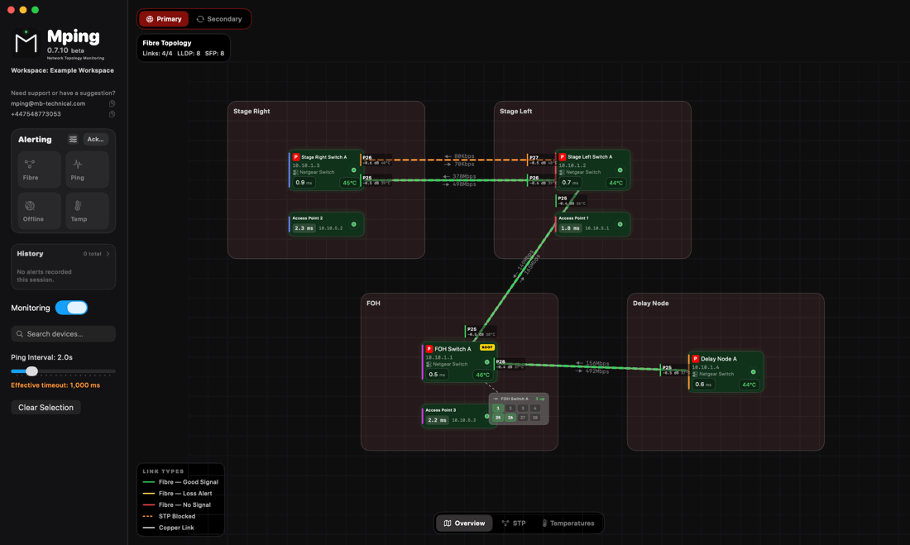
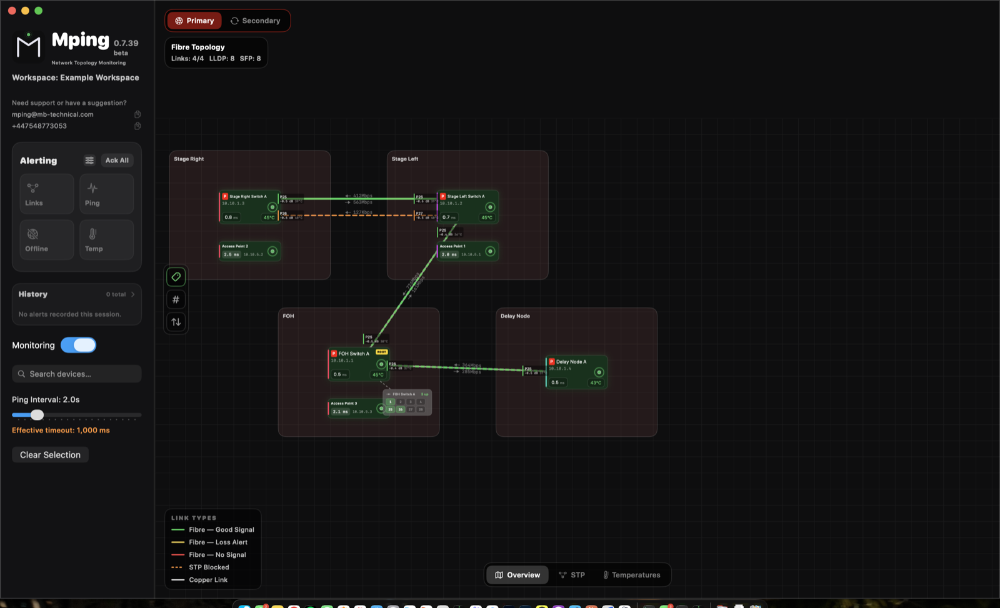
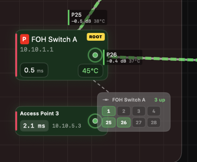
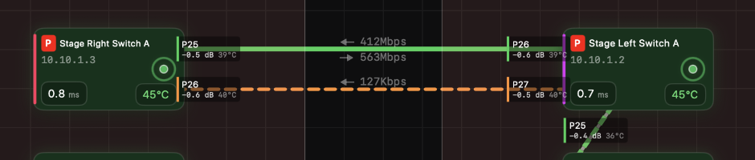
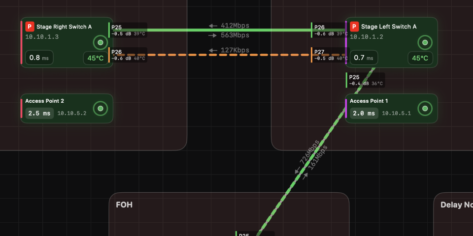
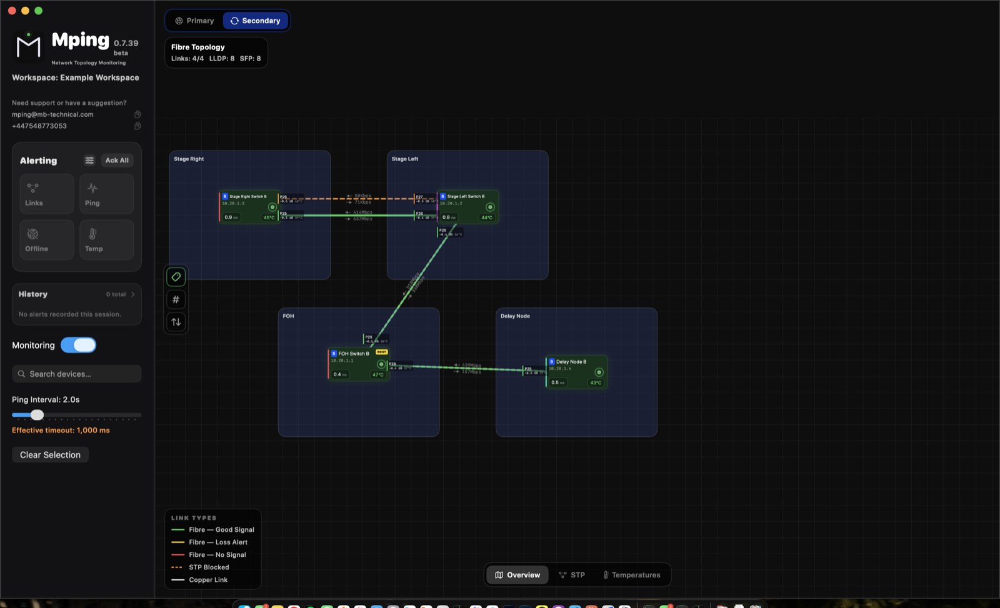
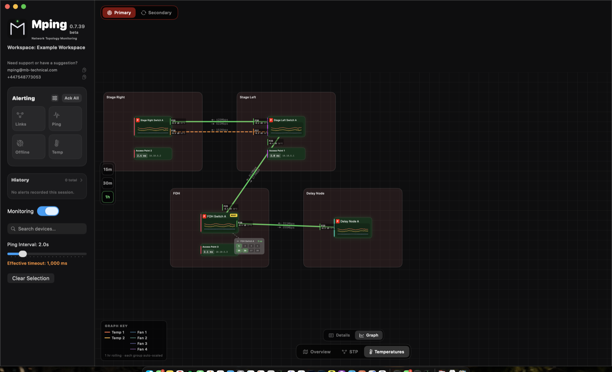
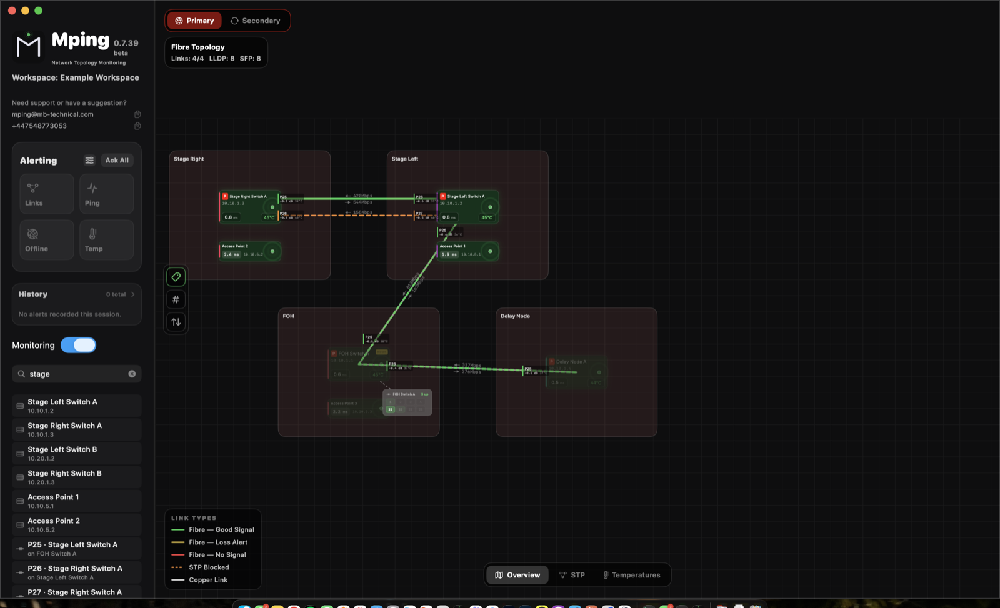
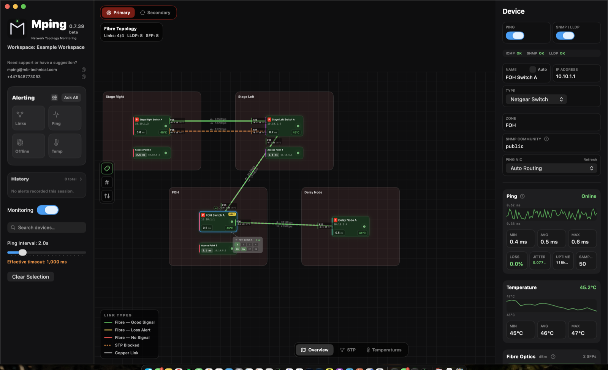
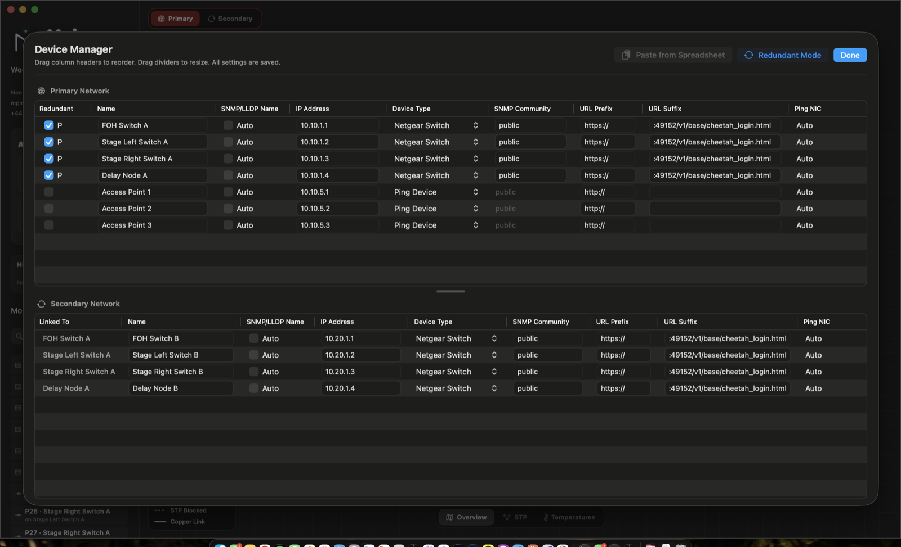

  

<h1 align="center">Mping</h1>

  <strong>Professional network monitoring for live event production.</strong> 
  Built for touring, festival, fixed installation, and live broadcast engineers.

  
  
  
  

---

## What is Mping?

Network monitoring built for show engineers, not IT departments. Everything on one canvas, readable at a glance from the FOH position.

- Know the instant a device drops — with **no false alerts**
- Your whole network as an interactive topology map
- The numbers that matter: RTT, jitter, packet loss, fibre loss, SFP temperature and signal
- Built around **Netgear AV**, **AVB/Milan**, **L-Acoustics** and fibre rigs

## Features

*Every screenshot below is Mping's built-in example workspace — a redundant four-switch fibre rig with access points — exactly as the app draws it.*

### The whole rig on one canvas

Every switch, amplifier and access point is a live tile — round-trip time, temperature and status readable from across the room. Fibre links are discovered automatically over LLDP and drawn with **per-end optical loss in dB** and **live per-port bandwidth**. Traffic direction animates toward the root bridge, and a blocked redundant path is drawn as exactly that — an orange dashed line, not a healthy link. Zone boxes group the rig the way it is racked, tiles drag freely, and a venue plan can sit behind everything (PNG, JPEG or PDF, with smart invert so black-on-white drawings read correctly on the dark canvas).

<table>
<tr>
<td width="55%" valign="top">

### Ping you can trust

A device is **never marked offline until a verification burst confirms it** — one lost packet on a busy network does not page you. Round-trip times are stamped by the kernel at packet arrival, so the numbers match `ping` in a terminal instead of inheriting the app's scheduling noise. Loss %, jitter and uptime are tracked per device, and jitter alerts only fire on a breach sustained across consecutive real cycles.

</td>
<td width="45%" valign="top">

</td>
</tr>
<tr>
<td width="55%" valign="top">

### Fibre and SFP optics, per module

Optical TX/RX power, temperature, voltage and laser bias for every SFP, read over DDM. Link labels carry the measured **loss of each direction** of every span, with alerts on your dB threshold — and a link whose light disappears goes red immediately. Copper SFPs are told apart from optical automatically, so the map never claims fibre where there is none.

</td>
<td width="45%" valign="top">

</td>
</tr>
<tr>
<td width="55%" valign="top">

### Spanning tree, drawn honestly

STP state lives right on the map: the root bridge wears a gold badge, blocked redundant paths draw as dashed amber, and traffic-flow arrows animate toward the root — computed from the switches' own designated-bridge votes. If the data cannot prove a direction, Mping draws **no arrow rather than a guessed one**.

</td>
<td width="45%" valign="top">

</td>
</tr>
<tr>
<td width="55%" valign="top">

### Redundant networks are first-class

Primary and secondary planes as two tabs of one workspace. Devices pair with their redundant twins, share canvas position and port-box layout, and wear P/S badges. Each plane keeps its own topology, its own link map and its own alert focus — clicking a secondary alert takes you to the secondary plane.

</td>
<td width="45%" valign="top">

</td>
</tr>
<tr>
<td width="55%" valign="top">

### Heat, before it becomes a problem

Both temperature sensors and all four fans of every switch, polled continuously with configurable alert thresholds. The Temperatures plane turns every tile into a **rolling one-hour graph** of sensors and fans, with hover readouts — a quiet rack at load-in and a hot one at showtime are one glance apart.

</td>
<td width="45%" valign="top">

</td>
</tr>
<tr>
<td width="55%" valign="top">

### Search that knows your patch

Search matches devices — and **switch ports**, by LLDP neighbour name or by the endpoint IP resolved from the switch's own learned-MAC and ARP tables. Type an device's IP and Mping finds the port it is plugged into, opens that switch's port box, and flashes the exact cell.

</td>
<td width="45%" valign="top">

</td>
</tr>
<tr>
<td width="55%" valign="top">

### One click, whole story

The inspector shows a device's live RTT sparkline, loss, jitter and uptime, temperature history, and a card per SFP — TX/RX, temperature, voltage, bias, vendor and serial. Per-device toggles for ping and SNMP monitoring, and a protocols strip showing per-transport health at a glance.

</td>
<td width="45%" valign="top">

</td>
</tr>
<tr>
<td width="55%" valign="top">

### Set up a rig in minutes

Add a show's worth of devices in one action, then **paste names and IPs straight from a spreadsheet** — the table fills live as you paste. Bulk-edit zone, type, community and monitoring state across a selection. In redundant mode the manager pairs both networks side by side.

</td>
<td width="45%" valign="top">

</td>
</tr>
</table>

### And for the engineer who reads spec sheets

- **Port status boxes** — a draggable companion per switch that replicates the physical racks with your kit in: per-column heights, drag-in placement, cells labelled with LLDP name, endpoint IP or drop counters, red-until-verified on reopen
- **Alerts that latch** — offline, RTT, jitter, fibre loss and temperature alerts stand until acknowledged, with full history; recovered-but-unacknowledged shows amber, and macOS notifications reach you when Mping is in the background
- **Hold ⌥ Option** to flip every tile's IP to its MAC address, learned live from the network
- **Honest by design** — topology memory is session-only: every launch draws only what the switches prove now, never yesterday's assumptions
- **One portable file** — a workspace is a single `.mpw` including the venue plan; open it on another Mac and the whole rig comes with it
- **Multi-NIC aware** — ping and SNMP bind to the interface you choose per device, built for FOH Macs riding two networks at once
- **Show-safe footprint** — engineered for low CPU and few wake-ups so the Monitoring Mac stays cool and silent; read-only throughout: Mping never writes a single setting to any device

---

## Install

1. Download **`Mping-x.y.z.dmg`** from the [**latest release**](https://github.com/therealjackiewelles/Mping/releases/latest)
2. Open it and drag **Mping** into Applications
3. **First launch: right-click Mping → Open**, then click Open again

> **Step 3 is not optional.** Mping is not yet notarised by Apple, so double-clicking it the first time shows a warning and refuses to launch. Right-click → Open is the way past it, and macOS only asks once. If macOS says the app is *"damaged"*, that is the same thing — the file is fine.

Workspaces are stored in `~/Documents/Mping`, never inside the app, so updates never touch your data.

**Updates:** Mping checks GitHub on launch and once a day. Feature releases offer to download and install themselves; patch releases are quiet — check any time via **Mping → Check for Updates…**. It is one anonymous request to GitHub. No account, no tracking.

---

## Setting up Netgear AV switches

Mping reads switch telemetry over SNMP — port status, temperatures, SFP levels, LLDP neighbours and STP state. The switch needs a read-only community string before any of that appears.

### 1. Create an SNMP community on the switch

In the switch's **main web UI** (not the AV UI), find the SNMP section — on M4250/M4300 it is under **System → SNMP → Community Configuration**.

- **Community string** — a name of your choosing, e.g. `mping`. This is effectively a password, so avoid `public` on a show network
- **Access mode** — **read-only**. Mping never writes to a switch, and read-write access is not needed
- **Client address** — restrict it to the Mac running Mping if your switch supports it, or leave open on a closed show network
- Make sure the community is **enabled**, and that SNMP itself is enabled on the switch

### 2. Add the switch in Mping

Right-click the canvas → **Add Device**, then in the inspector set:

- **IP address** of the switch
- **Type** → *Netgear Switch*
- **SNMP community** → the string you just created
- **Ping NIC** → the interface that reaches this switch

Telemetry appears on the next poll. If nothing arrives, open **Debugging → Console Output** and filter by subsystem to see exactly which OIDs were asked for and what came back.

### 3. What Mping does and does not do

Mping is **read-only by design**. It issues SNMP GET and WALK requests only, and never SET. It cannot change a switch's configuration, and the L-Acoustics HTTP integration is likewise GET-only.

---

## Redundant networks and dual NICs

A redundant rig usually means two physically separate networks — primary and secondary — often using **the same subnet on both**. That is where macOS gets in the way.

### The problem

With two NICs on overlapping subnets, macOS decides which interface to use from its routing table, not from which cable you meant. Replies arriving on the "wrong" interface are dropped by reverse-path filtering, so devices appear offline even though they are reachable.

### The fix — static host routes

Mping generates the routes for you. In **Preferences → Dual-NIC Static Routes**:

1. Set a specific **Ping NIC** on each device in the inspector — not *Auto Routing*. Only devices with an explicit NIC can be routed
2. Open the Dual-NIC Static Routes panel and press **Apply**
3. The commands are copied to your clipboard and Terminal opens — press **⌘V** then **Return**, and enter your admin password

This tells macOS exactly which interface to use for each device, so replies are accepted on the right one.

> **Remove the routes before you disconnect a NIC.** A static route pointing at an interface that is no longer there will black-hole all traffic to those devices until it is removed. The same panel has a **Remove** button.

### Primary and secondary

Once devices are paired, the **Primary / Secondary** tabs at the top of the canvas switch the whole view between the two networks. A secondary device sits in the same position as its primary, so the layout stays identical as you flip between them.

---

## Requirements

- macOS 13 Ventura or later
- Netgear AV switches for SNMP telemetry (any pingable device works for basic monitoring)
- A network route to the devices you want to monitor

---

## Ideas, questions and problems

- **Ideas & feature requests:** [Discussions](https://github.com/therealjackiewelles/Mping/discussions) — tell me what Mping should do. What you would use it for on a rig matters more than how it should work
- **Questions:** [Q&A](https://github.com/therealjackiewelles/Mping/discussions/categories/q-a)
- **Bugs:** [Issues](https://github.com/therealjackiewelles/Mping/issues)
- **Email:** mping@mb-technical.com · **Phone:** +44 7548 773053

[**How it works →**](ARCHITECTURE.md) — the system board: what runs when, and why.

---

## Trademarks & affiliation

Mping is an independent product. It is not affiliated with, endorsed by, or supported by NETGEAR or L-Acoustics. All trademarks belong to their respective owners.

## Licence

Proprietary — Copyright © 2026 Morgan Beecher / MB Technical. All rights reserved. See [LICENSE.md](LICENSE.md).

The application source is maintained in a private repository; this repository hosts releases, documentation, and the issue tracker.

---

## Recent releases

<!-- CHANGELOG:START -->

## v0.8.31 — 2026-10-21

**Map**
- A tile or location box can no longer be dragged off the edge of the map, where it could not be clicked, selected or dragged back; a group dragged together stops as one at the edge, and a showfile with an item beyond the edge brings it back when opened — https://github.com/therealjackiewelles/Mping/issues/163

**Pop-up windows**
- Pop-up windows (Settings, Network, Fix the Network, the Port Status Box Editor, switch logs, About and the debug windows) stay above the main window while Mping is in front, and cannot be minimised — https://github.com/therealjackiewelles/Mping/issues/159
- Escape closes the front-most pop-up whether or not it has focus; in a text field inside a pop-up the first Escape only leaves the field, and a sheet or help bubble on top keeps its own Escape — https://github.com/therealjackiewelles/Mping/issues/162
- With no pop-up open, Escape clears the search whether or not the search box has focus (a text field being edited elsewhere keeps its own Escape)
- Closing Settings with a changed amplifier username or password asks Apply / Don't Apply / Cancel instead of applying silently, on the close button, Escape, Quit and the update's Relaunch
- Settings is now Mping's own window (⌘, as before)
- The virtual-interface editor and Add Devices ask before Cancel or Escape throws away changes, and a Quit or the update's Relaunch also waits on the virtual-interface editor
- A closed Port Status Box Editor is now let go instead of being kept alive; one left open still costs more the longer it stays open (that issue stays open) — https://github.com/therealjackiewelles/Mping/issues/160

**Link lines**
- Link lines from a switch to its ping-only devices and Nemo meters are routed round other tiles instead of behind them; a device boxed in on all four sides keeps its straight line — https://github.com/therealjackiewelles/Mping/issues/158
- Link lines of different switches are kept off each other's stretches instead of lying on top of each other (they may still cross)
- A link line from a ping device or Nemo meter no longer runs along or hidden under a link between switches, and leaves a busy switch between two links instead of across one; it may still cross one where there is no way round
- Port boxes can sit closer to a ping-only device: the clear space around each tile now uses its real height, not the taller switch height
- When the adapter that reaches a switch is unplugged, every amplifier row behind it goes stale at once (grey, with the time last read) instead of staying green for about four minutes
- When a switch is confirmed offline, its amplifiers are pinged at once and the ones that do not answer go stale within seconds (grey, with the time last read) instead of staying green for about four minutes; no alert is raised for it
- With the adapters unplugged (or a switch silent for 90 seconds), the link lines of the switches that can no longer be read turn red like a link that is down, with no moving dashes, traffic figures or stale readings, instead of looking live (no Link Down alert is raised for them)
- Link lines are drawn twice as thick, in a stronger colour, with longer dashes
- Traffic figures on a link line can sit beside a vertical stretch, with up and down arrows, when no horizontal stretch has room

**Network window**
- Adapters is now split into Physical Interfaces and, at the bottom, Virtual Interfaces; the separate Virtual Interfaces section is gone and everything it held (the showfile's VLAN cards, Add Virtual Interface, the other VLANs on this Mac, remove-at-quit) is in that bottom part; each virtual interface is one card, with the devices set to it behind Show devices

**Under the hood**
- The About window and the console's launch row name the shared core by build number and date only
- The application log notes a Quit held for unapplied changes, and each Escape that closes a pop-up or is passed on, with the reason
- Unused files were removed from the app
## v0.8.30 — 2026-10-10

**Network window**
- NTP & Syslog: when a time server is switched on, applied, or brought in by a showfile, every switch's clock is read at once (and re-read every ten seconds until it locks on) instead of waiting for the next slow lap
- NTP & Syslog: a remove button beside each side's address takes that side off — the address comes off the adapter through the helper, the time server restarts without it, and the showfile follows

**Fixes**
- Pasting or duplicating one half of a redundant pair now makes a plain device, and pasting both halves makes a new pair linked to each other (a copy used to keep the original's partner link) — https://github.com/therealjackiewelles/Mping/issues/154
- Deleting either half of a redundant pair now asks first and deletes both (before, a secondary could be deleted on its own, leaving its primary standalone, and cut and the right-click menu deleted without asking)
- The amp stream alert now reads "Primary audio feed dropped — stream 1 waiting for the media clock · 0 of 1 locked" (was "Streams unlocked — P 0/1"): the network, the stream, and whether it is unlocked, disconnected or waiting for the media clock
- Amp AVB fault rows (stream and clock-stream errors, a clock leg not locked, fault counters climbing) show on the first reading that sees them (they waited for two), so a brief drop is no longer forgiven; a reading that carried no AVB data never clears one
- An amp losing a stream or showing a fault on one network now alerts on that network's switch only — raised there by whichever switch's poll caught it, since the two poll the amp in turn and a brief drop may land in either (both switches used to report everything)
- Acknowledging alerts updates the screen at once instead of on the next redraw tick (up to a quarter of a second later)
- After an update changes the privileged helper, Mping now waits as long as macOS takes to switch it back on (checking every second for a minute, then every half minute), remembers it once it is on, and puts the time-server address, interfaces and routes on at that moment — launches no longer repeat the re-registration, and a declined setup panel no longer leaves the helper unused for the whole run
- The link map rebuild (which switch is cabled to which, after every LLDP sweep) does about half the work it did: the name-matching data is built once per rebuild instead of once per link, so the rebuild costs less CPU, especially while the window is hidden
- Links between switches are matched by hardware address alone: a neighbour that reports an address no device on the map has is no longer matched by its name (names still decide the rare row that reports no address). The rebuild also matches each switch's table once instead of twice and builds link ids without a text round trip, so it costs under a third of what it did
- A ping-only device that sits alone on a switch port now shows that port's traffic on its link line to the switch, in the same two-arrow form as the switch-to-switch labels (a port shared with other devices, such as an access point, a port with no traffic, and ports on LS10 switches show nothing)
- Devices stacked under (or over) their switch no longer have their link lines run behind the tiles above them: the stack gets one shared rail beside it with a short stub into each tile, and the port chip and traffic figures sit on the stub in clear space (a lone device with a clear line keeps its straight line)
- The marching dashes on the link lines no longer sit still on a Primary or Secondary tab that has been out of view: they began late by as long as the tab had been hidden (up to an hour on a Secondary left alone), and the lines whose direction did not change when the view switched between spanning tree and clock never started
## v0.8.29 — 2026-10-06

**Fixes**
- The frame-size check no longer sends test pings to a device Mping is holding out of polling
- Two overlapping route requests to the helper can no longer leave a stale route pin: each request now waits for the one before it

**[Full changelog →](CHANGELOG.md)** — every release since v0.3.0.

<!-- CHANGELOG:END -->
